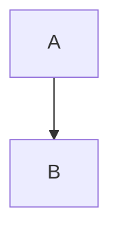

# Features & safety

## Duplicate
## Duplicate
## Duplicate-2
## 日本 語

Paragraph with **strong**, *emphasis*, ~~deleted~~ and `inline <code>`.

> A quoted paragraph.

---

1. Ordered
2. List

- Unordered
- [ ] Pending task
- [x] Completed task

| Name | Value |
| --- | ---: |
| Table | 42 |

```javascript
const answer = "safe <script>";
```



```unknown-<script>
<script>neverExecute()</script>
```


![Reference pixel][pixel]


[pixel]: Images/pixel.png "Referenced raster"

[Fragment](#日本-語)
[Markdown](space%20%C3%BC%20%E6%97%A5%E6%9C%AC.markdown#target)
[Outside markdown](../outside.md)
[Web](https://example.com/report)
[Email](mailto:reader@example.com)
[Reveal](Images/pixel.png)
[Unsafe](javascript:alert(1))
[Custom](unsafe-custom:run)
[Executable](run.command)

<script>window.documentExecuted = true</script>

<svg onload="window.documentExecuted=true"></svg>
</script> ' " ` ${notEvaluated} & <iframe src="https://mdviewer-m0.invalid/"></iframe>
