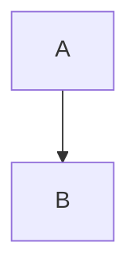

# MDViewer feature showcase

This document exercises everything MDViewer renders, and shows what it deliberately
blocks. Open it with MDViewer:

```bash
open -a MDViewer examples/showcase/showcase.md
```

Each section says what you should see. Anything that looks different is a bug.

## Contents

- [Text formatting](#text-formatting)
- [Headings and anchors](#headings-and-anchors)
- [Lists and task lists](#lists-and-task-lists)
- [Tables](#tables)
- [Code and syntax highlighting](#code-and-syntax-highlighting)
- [Images](#images)
- [Links](#links)
- [Unicode and long content](#unicode-and-long-content)
- [Blocked content](#blocked-content-security)
- [Live features to try](#live-features-to-try)
- [Not supported](#not-supported)

## Text formatting

Plain paragraph text wraps to the window width. A single line break in the source
does not start a new line; a blank line starts a new paragraph.

**Bold**, *italic*, ***bold italic***, ~~strikethrough~~, and `inline code`.
Escaped characters stay literal: \*not italic\*, \`not code\`, \# not a heading.

> A blockquote.
>
> > A nested blockquote, with **formatting** and `code` inside.

Horizontal rule below:

---

Typographer replacements are off: "straight quotes" and -- double dashes stay as typed.

## Headings and anchors

Every heading gets an anchor, so fragment links work. Link to a heading with `#` plus
its slug: lowercase, spaces become dashes, punctuation is dropped. The next two
headings have the same text; the second gets a `-2` suffix.

### Repeated heading

First copy: `#repeated-heading`.

### Repeated heading

Second copy: `#repeated-heading-2`. [Jump to the first copy](#repeated-heading).

#### Level 4 heading

##### Level 5 heading

###### Level 6 heading

## Lists and task lists

1. Ordered item
2. Ordered item with a nested list
   - unordered child
   - another child
     1. deeper ordered child
3. Ordered item with a paragraph

   A second paragraph inside the same item.

- [x] Task lists render as checkboxes
- [ ] Unchecked task
- [ ] Checkboxes are **disabled**: the viewer never edits your file

7. A list can start at any number
8. ...and continues from there

## Tables

| Left aligned | Centered | Right aligned |
|:-------------|:--------:|--------------:|
| apples       |    3     |          1.20 |
| bananas      |    12    |         10.05 |
| `code` cell  | **bold** |   ~~struck~~  |

A wide table scrolls sideways instead of breaking the layout:

| Column 1 | Column 2 | Column 3 | Column 4 | Column 5 | Column 6 | Column 7 | Column 8 | Column 9 | Column 10 |
|---|---|---|---|---|---|---|---|---|---|
| a fairly long cell value | another long cell value | more text here | and here | and here too | still going | nearly there | almost | last-but-one | done |

## Code and syntax highlighting

Highlighted languages: JavaScript, TypeScript, JSON, CSS, XML/HTML, Bash, Python and Swift.

```swift
struct Greeting {
    let name: String
    func render() -> String { "Hello, \(name)!" }
}
```

```python
def fib(n: int) -> int:
    return n if n < 2 else fib(n - 1) + fib(n - 2)
```

```typescript
type Mode = "light" | "dark";
const pick = (dark: boolean): Mode => (dark ? "dark" : "light");
```

```javascript
document.querySelectorAll("h2").forEach(h => console.log(h.id));
```

```json
{ "viewer": "MDViewer", "offline": true, "plugins": [] }
```

```css
.changed-flash { outline: 2px solid AccentColor; }
```

```xml
<note priority="high">Rendered as highlighted code, never as live HTML.</note>
```

```bash
swift build -c release && open -a MDViewer README.md
```

Any other language, and Mermaid, shows as plain escaped code:



```
A fence with no language at all.
```

    An indented code block (four spaces).

## Images

Supported local formats are PNG, JPEG, GIF and WebP, loaded from the document's
folder or its subfolders.

PNG:


JPEG, with a title (hover over it):


GIF and WebP side by side, as inline images:

 

A reference-style image: ![Gradient again][gradient-ref]

[gradient-ref]: images/gradient.png

A path with `..` that stays inside the folder still works:


A missing image shows a placeholder, not a broken page:


## Links

- Fragment link: [back to Contents](#contents)
- Another Markdown file opens in its own MDViewer window: [second page](second-page.md)
- A Markdown link with a fragment: [second page, section B](second-page.md#section-b)
- External web link, opened in your default browser: <https://www.markdownguide.org/>
- Named web link: [CommonMark spec](https://spec.commonmark.org/)
- Email link, opened in your mail app: [mailto example](mailto:someone@example.com)
- Bare URLs are **not** turned into links (linkify is off): https://example.com

## Unicode and long content

Unicode text: Grüße · こんにちは · Привет · مرحبا · שלום · 🙂 🚀 ✅

Math-like text stays plain: E = mc², ∑ xᵢ, α → β.

A very long unbroken word wraps or scrolls without stretching the page:
Supercalifragilisticexpialidocious-supercalifragilisticexpialidocious-supercalifragilisticexpialidocious

### Überschrift mit Umlauten

Non-ASCII headings get readable anchors too: [link to it](#überschrift-mit-umlauten).

## Blocked content (security)

MDViewer is offline and treats documents as untrusted. All of the following are
blocked on purpose.

Raw HTML is shown as text, not executed:

<script>alert("this never runs")</script>

<b>these tags</b> appear literally, and  does nothing.

A remote image never loads (no network requests):


An image outside the document folder is blocked:


Dangerous link schemes do nothing when clicked:
[javascript link](javascript:alert(1)) · [file link](file:///etc/hosts) · [data link](data:text/html,hi)

## Live features to try

These need you to interact with the app:

1. **Live refresh.** Edit and save this file in any editor. The preview updates and
   keeps the paragraph you were reading in place, even when you add text above it.
2. **Follow Changes** (View menu, ⇧⌘F). Turn it on, scroll to the top, then edit the
   end of this file and save. The preview scrolls to the change and highlights it briefly.
3. **Image refresh.** Run `python3 scripts/make-showcase-images.py`, or replace,
   delete or re-create any file in `images/`. The preview updates by itself;
   ⌘R still forces a reload. Changes to files the document doesn't reference are ignored.
4. **Find** (⌘F), **zoom** (⌘+ / ⌘− / ⌘0), and **dark mode** (switch macOS
   appearance; the page follows it).
5. **Reload** (⌘R) re-reads the file and its images.

## Not supported

These Markdown extensions are not part of MDViewer's renderer and show as plain text:

- Footnotes: Here is a footnote marker[^1].
- Math blocks: $$ \int_0^1 x^2 \, dx $$
- Mermaid diagrams (shown as code above)
- Emoji shortcodes: :smile:
- Definition lists, superscript/subscript syntax, admonitions

[^1]: This line also stays as plain text.

The end. [Back to the top](#mdviewer-feature-showcase)
